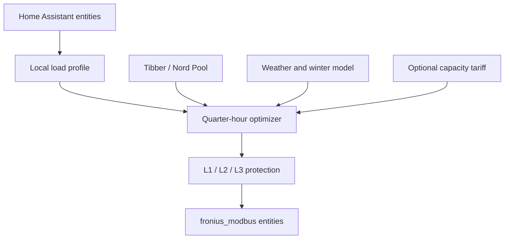

# GridShift Battery Optimizer

This repository contains the Home Assistant runtime adapter for GridShift and
is installable through HACS. The GridShift application is developed separately
in [`karobolas-cmyk/gridshift`](https://github.com/karobolas-cmyk/gridshift).

GridShift is a provider-independent energy optimizer whose first runtime adapter
is Home Assistant. It charges a home battery in low-cost intervals while
respecting the least available headroom across all three phases. It is designed
around Swedish electricity conditions, quarter-hour prices, weak winter solar
production, electric heating, EV charging, and grid capacity tariffs.

Configuration belongs in the GridShift application. Adding this integration in
Home Assistant creates a local bridge and does **not** ask you to select
entities. Connect the Home Assistant home in GridShift afterward; discovery,
review, and entity mapping happen there.

If Home Assistant still shows the old Fronius entity selectors, update the HACS
integration to version 0.9.1 or later and restart Home Assistant before adding
the integration again.

The Home Assistant setup screen for a new bridge contains only a confirmation
button; no battery, inverter, price, meter, or phase entity is required there.

After reviewing the discovered entities in GridShift, **Configure bridge &
import values** calls the integration's restricted `apply_configuration`
service. The service accepts only GridShift's documented mapping and safety
fields, validates them locally in Home Assistant, reloads the integration, and
creates the dedicated control switches. It cannot proxy arbitrary Home
Assistant service calls. Control remains off after configuration.

The battery control path is native to
[`callifo/fronius_modbus`](https://github.com/callifo/fronius_modbus). GridShift
uses its `Storage Control Mode`, `Grid Charge Power`, and optional
`Grid Discharge Power` entities instead of writing directly to Modbus.

Open the private live-control dashboard:
[GridShift Battery Optimizer](https://gridshift-battery-lab-6ddf9da3.exactmatch.chatgpt.site).

> GridShift can control physical high-power equipment. Automatic control starts
> disabled. Verify the recommendation sensors and use conservative limits before
> enabling it.

## Highlights

- 15-minute prices and 96 planning intervals per day.
- Native Tibber price retrieval through Home Assistant.
- Home Assistant Nord Pool support plus an experimental direct Nord Pool source
  in the hosted dashboard.
- The official local Home Assistant Fronius integration as a secondary read
  source for additional inverters, SolarNet, Smart Meter, and storage data.
- Fronius, Sigenergy, SolarEdge, Enphase Envoy, GoodWe, SMA, Growatt, SolaX,
  Victron, Sungrow, Huawei, Tesla Powerwall, sonnen, AlphaESS, FoxESS,
  GivEnergy, and generic Home Assistant solar power sensors, including summing
  multiple sources and automatic system detection with manual override.
- Charge Amps, Easee, Zaptec, Sigenergy EVAC/EVDC, Wallbox, Tesla Wall
  Connector, go-e, myenergi Zappi, OCPP, Fronius Wattpilot, KEBA, OpenEVSE,
  Ohme, Peblar, Amina, and generic Home Assistant EV power sensors.
- House-load, multi-source solar, multiple EV chargers, and L1/L2/L3 entity
  mapping.
- Phase-current freshness protection with a configurable maximum age. Stale,
  unavailable, or non-numeric phase data blocks charging and returns any
  GridShift-owned Fronius mode to `Auto`.
- Multiple named Home Assistant homes with isolated entity mappings, plans, and
  thermostat scopes in the hosted dashboard.
- Live hosted control of the integration's **Automatic battery control** and
  **Allow discharge to grid** switches. Other Home Assistant services remain
  blocked by the dashboard relay.
- A rolling price horizon that includes tomorrow when published, keeps the
  current quarter centered, and explains every quarter using price, solar,
  capacity tariff, weather, and COP.
- A live energy-flow overview with directional solar, grid, home, battery, and
  EV indicators plus a state-of-charge-filled battery gauge.
- Click-to-toggle manual charge-plan overrides with SoC and phase safety still
  enforced.
- Optional grid discharge requires its own explicit switch and only uses energy
  above the adaptive SoC reserve when the modeled spread covers efficiency,
  cycle cost, and the configured minimum saving.
- Swedish winter model from 15 November through 15 March, with conservative
  solar credit and temperature-dependent heating reserve.
- Optional capacity-tariff optimization with configurable peak model, rate,
  current billing-period peak, and active hours.
- Experimental thermal planning using weather, COP, thermal mass, and price.
- Per-thermostat baseline, maximum deviation, price response 1–10, strategy, and
  heat/cooling direction.
- Thermostat health checks using current state freshness and the previous 24
  hours of Home Assistant history before an entity can be selected.
- House construction profiles plus optional indoor-temperature history for an
  initial thermal-mass estimate.
- English is the project and UI default; Swedish is available from the language
  switch.

## Architecture



The optimizer core is independent of Home Assistant and is covered by unit tests.
Home Assistant is the first provider adapter and is currently responsible for
entity discovery, local history, scheduling, recommendation sensors, and the
explicit opt-in control switches. Future Homey and direct-inverter adapters can
implement the same measurement, planning, and actuation contracts without
changing the optimizer.

## Requirements

1. Home Assistant 2024.8 or newer.
2. A battery-capable Fronius inverter exposed by `fronius_modbus`.
3. Modbus TCP and control enabled on the inverter.
4. A usable state-of-charge sensor.
5. Three phase-current sensors, from a Fronius Smart Meter, Tibber Pulse, or
   another Home Assistant integration.
6. The home's main-fuse rating, configured manually when no integration exposes
   a reliable value.
7. A price entity or the Home Assistant Tibber integration.

Disable competing scheduled charge/discharge rules in Fronius. GridShift first
selects the operating mode, waits 20 seconds by default, and only then writes the
power entity used by that mode, matching the contract documented by
`fronius_modbus`.

## Installation with HACS

1. Open **HACS → Integrations**.
2. Open the menu in the top-right corner and choose **Custom repositories**.
3. Add `https://github.com/karobolas-cmyk/grid-shift-ha` with category
   **Integration**.
4. Open **GridShift Battery Optimizer** in HACS and select **Download**.
5. Restart Home Assistant.
6. Open **Settings → Devices & services → Add integration** and search for
   **GridShift Battery Optimizer**.

For a manual installation, copy `custom_components/gridshift_battery` into Home
Assistant's `config/custom_components/` directory, restart Home Assistant, and
add the integration from **Settings → Devices & services**.

## Entity mapping

The setup flow first asks for the Fronius control entities:

| GridShift field | Typical `fronius_modbus` entity |
| --- | --- |
| Battery state of charge | `State of Charge` sensor |
| Storage control mode | `Storage Control Mode` select |
| Grid charge power | `Grid Charge Power` number |
| Grid discharge power | `Grid Discharge Power` number (optional) |
| House load | Whole-home load sensor |
| Phase currents | `Current L1`, `Current L2`, `Current L3` |

For the BYD storage shown by `callifo/fronius_modbus`, GridShift deliberately
uses only these three storage states:

| Storage control mode | Number entity used after the mode settles |
| --- | --- |
| `Auto` | None; returning control only selects `Auto` |
| `Charge from Grid` | `number.*_grid_charge_power_*` |
| `Discharge to Grid` | `number.*_grid_discharge_power_*` |

`number.*_pv_charge_limit_*` and `number.*_discharge_limit_*` belong to the
separate PV/limit modes and are not used for GridShift's grid charging or grid
export. The setup flow checks that the selected storage-control entity exposes
the required mode names before it accepts the configuration.

Then select electricity price, house load, and optional solar, EV, and outdoor
temperature integrations. GridShift proposes matching entities from the Home
Assistant entity registry, including L1/L2/L3 in order, and then asks for
confirmation. Every suggestion has a manual override. Multiple solar and EV
power entities can be selected and summed. This supports a second inverter exposed by Home Assistant's official
local Fronius integration, a Sigenergy plant, and homes with more than one EV
charger. Power sensors in W, kW, and MW are supported. Keep **House load
already includes EV charging** enabled unless the load entity explicitly excludes
the charger.

For Tibber Pulse, select **Power / Effekt** (`sensor.power_*`) for live grid
import. **Average power / Genomsnittlig effekt**, minimum and maximum power are
statistics and must not be used for instantaneous flow or household demand.
Grid import includes battery charging. Prefer a dedicated house-load sensor;
otherwise map measured battery net power (positive when charging), or both
measured battery charging and discharging power, plus grid export when available.
The bridge derives household demand as grid import minus export plus solar minus
net battery charging. Measurement sensors must report W, kW or MW and be fresh.
`number.*_grid_charge_power` is a requested setpoint, not a measurement.

The action sensor includes a rolling `plan` with its generation time, actual SoC,
stored usable energy, reserve shortfall and projected SoC for each remaining
interval. Input changes and quarter boundaries rebuild this plan from actual SoC.
Missed or failed charge commands are never credited as stored energy. Projection
describes expected future operation; measured reserve describes energy available
now. A forced action affects the current interval while the future plan continues
to be calculated. A latched actuator failure still requires explicit re-enabling
before any new physical commands are sent.

EV charger support is entity-based. GridShift reads live charging power for load
forecasting, phase-aware battery planning, and capacity-tariff calculations. The
hosted preview remains read-only and does not start, stop, or change charger current.
Vendor-specific charger actuation will be added behind a separate opt-in safety
switch after its service and entity contracts are tested per integration.

## Prices

GridShift preserves the source timestamps, so hourly and quarter-hour values do
not need to be rescaled. Supported price attributes include:

- `raw_today` and `raw_tomorrow` objects with start, end, and value fields;
- `prices` arrays with timestamped price objects;
- Home Assistant Tibber prices through `tibber.get_prices`.

The hosted preview can also retrieve Nord Pool day-ahead data directly. Configure the
area, VAT, and fixed markup. Home Assistant's Nord Pool integration remains the
preferred local source when available.

## Capacity tariffs

Capacity-tariff support is disabled by default. When enabled, configure:

- peak model: highest peak, top-three average, or top-five average;
- demand rate in SEK/kW;
- the current billing-period reference peak in kW;
- the hours during which the tariff is active.

For each candidate charge interval, GridShift estimates whether charging would
raise the recorded peak. The expected incremental fee is converted to an effective
per-kWh planning cost and added to the spot price. This lets a cheap interval lose
to a slightly more expensive interval when the cheap interval would create a new
demand peak. See [capacity tariffs](docs/capacity-tariffs.md).

## Swedish winter model

Between 15 November and 15 March, GridShift uses conservative assumptions even
when the weather forecast is sunny. Only a configurable fraction of forecast solar
energy is credited, the SoC target receives an additional floor, and a heating
reserve is calculated from outdoor temperature. This prevents short days and low
sun angles from leaving the battery empty before an expensive evening.

## Thermal planning

The hosted preview reads hourly forecasts from `weather.get_forecasts` and discovers
`climate.*` entities. Every selected thermostat has its own:

- normal baseline, such as 22 °C;
- maximum deviation from that baseline;
- price response from 1 to 10;
- continuous or peak-only price strategy;
- automatic or explicit `heat`, `cool`, or `heat_cool` direction.

Heating setpoints move down during expensive intervals. Cooling/AC setpoints move
up, and `heat_cool` widens its band around the baseline. These are simulated
recommendations only; the hosted preview never writes thermostat commands. See
[thermal control](docs/thermal-control.md).

The thermal model includes generic profiles for air-to-air, air-to-water,
borehole ground-source, horizontal ground-loop, and resistive heating. Each
profile changes how COP responds to outdoor temperature, while SCOP remains
manually adjustable. See [heating profiles](docs/heating-profiles.md).

## Three-phase protection

For symmetric three-phase charging, available power is limited by the most loaded
phase:

$$
P_{phase}=3 \cdot U_{phase} \cdot
\min_i\left(I_{fuse}-I_{margin}-I_i\right)
$$

Main-fuse size is stored per named home. The preview can suggest a value when a
Home Assistant entity or attribute explicitly exposes one, but it never guesses
from measured phase current. Tibber's API has a `mainFuseSize` home field, while
the standard Home Assistant Tibber sensor set does not currently document it as
an exposed sensor, so manual confirmation remains the safe default.

The previous battery command is added back before recalculation because the meter
already includes the active battery load. This prevents the control loop from
reducing its own command on every update. The final Fronius command is rounded down
to 10 W.

## Fronius write sequence

Every special storage mode follows the same state machine:

1. Select `Charge from Grid` or `Discharge to Grid`.
2. Wait the configured settle time, 20 seconds by default.
3. Verify that the matching number entity is available.
4. Write `Grid Charge Power` or `Grid Discharge Power` in 10 W steps.
5. When the action ends, select `Auto`. No 0 W write is sent during release.

The wait is performed when entering or changing a special mode. Later rate
updates in the already active mode can write the same mode-specific number
directly; reselecting the mode would reset that number to zero.

Grid export has a second, independent **Allow discharge to grid** switch. Both
that switch and **Automatic battery control** must be enabled before physical
discharge can occur. The current price entity is used as the export-value proxy,
so confirm that its values match the compensation relevant to your contract.

## Safe startup

Automatic control is off after installation. Before enabling it, verify:

- the recommended power is zero when any phase has no safe headroom;
- L1, L2, and L3 are mapped in the correct order;
- the oldest-phase-sensor-age diagnostic remains below the configured limit;
- house load does not double-count EV charging;
- the price forecast covers the planning horizon;
- state of charge and battery capacity are correct;
- capacity-tariff settings match the grid-company tariff;
- Fronius mode values match the configured options.
- grid discharge remains off until its separate switch and economics have been
  reviewed.

Missing price, state-of-charge, or phase data blocks new charging. When GridShift
is disabled or unloaded, it returns Fronius to `Auto` when GridShift owns the
active control mode.

## Development

```bash
python -m pytest
ruff check custom_components tests
```

The tests cover price formats, hourly and quarter-hour planning, phase limits,
active-command feedback, winter reserve, local learning, capacity tariffs,
discharge opt-in, and the mode-wait-power write order.

## Known limitations

- The installable integration is intentionally three-phase.
- Direct Nord Pool access in the hosted preview depends on the public data endpoint;
  Home Assistant remains the recommended production path.
- Thermal setpoints are simulated and are not yet written by the integration.
- Grid-discharge economics currently use the configured price series as an
  export-value proxy; tariffs and export compensation can differ by contract.
- Capacity-tariff models are estimates; grid-company billing rules and taxes vary.
- EV departure-time planning and a full 24–48 hour linear optimizer are future
  work.

See [architecture](docs/architecture.md) for module boundaries and safety rules.
