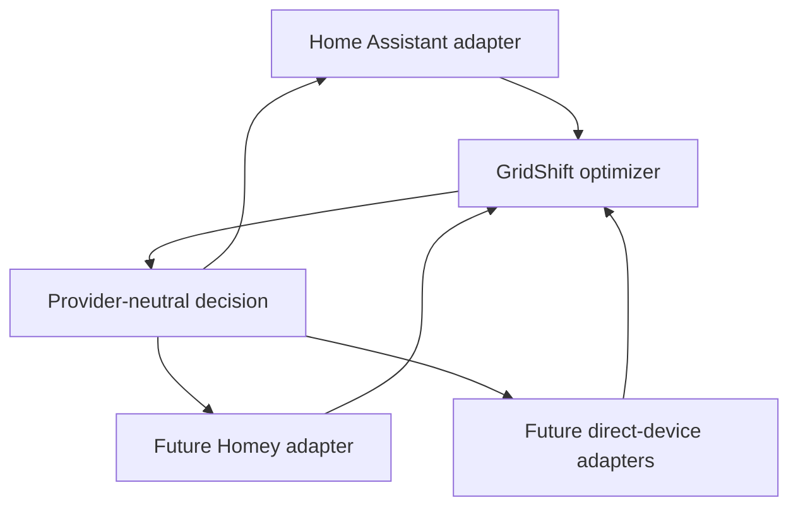
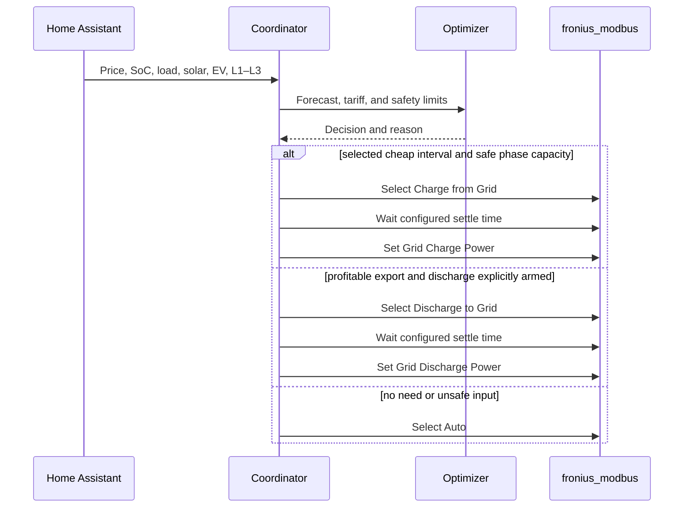

# Architecture

GridShift separates the optimizer core from Home Assistant and the physical
inverter so planning behavior can be tested without either dependency.

## Provider boundary

Home Assistant is an adapter, not the optimizer's domain model. A provider must
implement three contracts:

| Contract | Responsibility |
| --- | --- |
| Measurements | Supply prices, SoC, load, solar, EV, weather, and phase current. |
| Control | Expose explicit automatic-control and grid-discharge opt-ins. |
| Actuation | Enter a device mode, wait for readiness, write its rate, and release safely. |

The current hosted dashboard controls only GridShift's two Home Assistant
switches. It does not bypass the adapter or write directly to an inverter. A
future Homey or direct-device UI can preserve the same controls and safety state
machine while changing the transport underneath.

## Modules

| Module | Responsibility |
| --- | --- |
| `price.py` | Normalizes common price attributes into timed intervals. |
| `learning.py` | Learns local 30-minute load, solar, and EV profiles. |
| `optimizer.py` | Produces deterministic price-, tariff-, and phase-constrained decisions. |
| `coordinator.py` | Reads Home Assistant state, updates the model, and schedules planning. |
| `controller.py` | Writes safely to `fronius_modbus` select and number entities. |
| `sensor.py` | Exposes recommendations, constraints, and explanations. |
| `switch.py` | Provides independent opt-in switches for control and grid discharge. |

## Event sequence

The select-and-wait transition runs when entering or changing the special mode.
Subsequent power changes in the same settled mode update its number directly.
Selecting the mode again would reset the mode-specific power number.

## Control ownership

The controller records whether automation is enabled and whether GridShift owns
the current Fronius mode. It only restores a mode that it owns or that is still
`Charge from Grid`, or an explicitly armed `Discharge to Grid`. An unexpected
manual mode disables automation and returns `manual_mode_override`.

## Failure principles

- Missing future price data → `blocked`; no new charging.
- Invalid SoC → `blocked`.
- Less than 100 W safe phase capacity → `blocked`.
- Failed write → `control_write_failed` in sensor state and an error in the log.
- Disabled switch → recommendations only, no writes.
- Integration unload → `Auto` when GridShift owns control.

## Next optimization level

The current deterministic allocation can later be replaced with a linear model
without changing the Home Assistant or Fronius layers. A future model should make
15-minute charge, discharge, and SoC decisions with constraints for efficiency,
export, capacity tariffs, phase balance, thermal loads, and EV departure time.
